### Выбор метрик для мониторинга

Метрики разделены на две группы: метрики сервиса и метрики среды выполнения Python.

**1. Метрики сервиса**

Для оценки работы HTTP API используются следующие метрики:

- `http_requests_total` - общее количество обработанных HTTP-запросов. Метрика позволяет определять интенсивность поступающих запросов и отслеживать долю ответов с кодами ошибок 5xx. Она используется для выявления ситуаций, при которых сервер начинает возвращать большое количество ошибочных ответов.
- `http_request_duration_highr_seconds_bucket` - гистограмма длительности обработки запросов. На её основе рассчитывается 95-й перцентиль времени ответа, позволяющий оценивать задержки для большинства запросов и выявлять ухудшение производительности.

**2. Метрики Python runtime**

Для контроля потребления ресурсов процессами Python используются:

- `process_resident_memory_bytes` - объём физической оперативной памяти, занимаемой процессом. Метрика позволяет выявлять чрезмерное потребление памяти, которое может привести к нехватке ресурсов и нестабильной работе приложения.
- `process_cpu_seconds_total` - накопленное процессом время использования CPU в секундах. На основе скорости изменения этой метрики определяется средняя загрузка процессора. Она позволяет выявлять ситуации, когда приложение длительное время потребляет значительную часть доступных вычислительных ресурсов.

Для всех метрик используются фильтры по пространству имён `devbug` и именам pod серверной части `backend-*`.

### Настройка правил алертинга

На основе выбранных метрик разработаны четыре правила алертинга: два для контроля работы HTTP API и два для контроля ресурсов Python-процессов.

**1. Алерты сервиса**

- `HighHTTPErrorRate` - срабатывает, если доля HTTP-ответов с кодами 5xx превышает 5% от общего количества запросов за последние 5 минут. Дополнительно проверяется, что за этот период обработано не менее пяти запросов. Это позволяет избежать ложных срабатываний при низкой нагрузке.
- `HighHTTPLatency` - срабатывает, если 95-й перцентиль времени обработки HTTP-запросов превышает 1 секунду за последние 5 минут. Такой порог позволяет обнаруживать существенное замедление ответов API.

**2. Алерты Python runtime**

- `HighPythonMemoryUsage` - срабатывает, если объём используемой процессом оперативной памяти превышает 300 MiB.
- `HighPythonCPUUsage` - срабатывает, если средняя загрузка CPU процессом превышает 0,8 ядра за последние 5 минут.

Для всех четырёх правил установлено условие `for: 5m`: превышение порогового значения должно сохраняться в течение пяти минут, прежде чем алерт перейдёт в состояние срабатывания. Это снижает вероятность уведомлений о кратковременных колебаниях нагрузки.

Каждому правилу назначены метки `severity` и `category`. Первая определяет уровень важности уведомления, а вторая разделяет алерты на сервисные и runtime-алерты. Эти метки используются при группировке уведомлений в Alertmanager.

### Тестирование алертов

Для тестирования работы алертов в настройках были временно изменены параметры (например, снижен порог потребления памяти или времени обработки запросов). После тестирования все настройки были возвращены

После настройки алертов была выполнена проверка их загрузки и запуска с помощью команды kubectl logs deployment/vmalert -n devbug. В логах отображаются три группы правил: сервисные алерты, runtime-алерты и правила SLO.
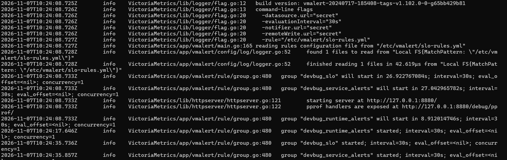

В интерфейсе vmalert на вкладке Groups отображаются созданные группы правил и входящие в них алерты
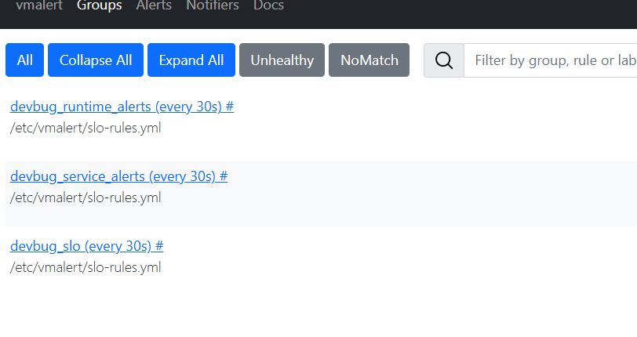

Для отслеживания состояния алертов используется страница http://localhost:8880/vmalert/alerts. Статус pending означает, что условие срабатывания выполняется, но ещё не выдержан заданный интервал for, а firing - что условие сохранялось необходимое время и алерт перешёл в активное состояние.

После временного снижения порога потребления памяти алерт HighPythonMemoryUsage перешёл в состояние pending на трёх репликах backend.
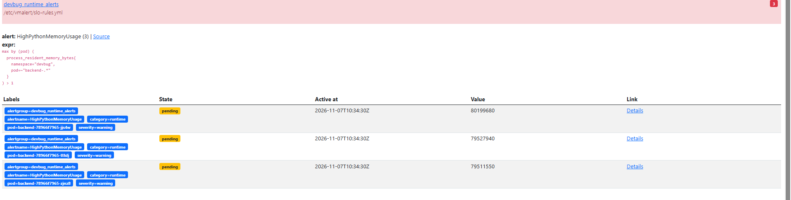

После перехода алерта в активное состояние Alertmanager отправил уведомление в Telegram-бот с названием алерта, метками и описанием проблемы.
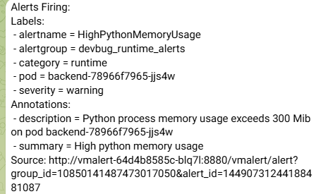

По истечении установленного интервала for: 5m алерт HighPythonMemoryUsage перешёл в состояние firing.
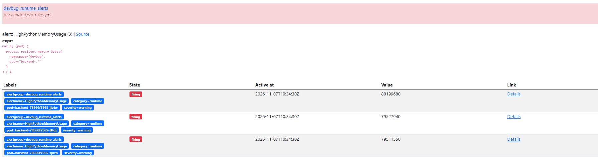

После возврата к исходным параметрам алерт перешёл в статус resolved.

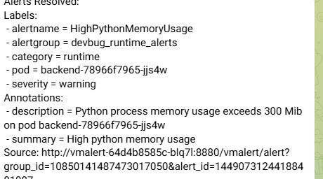

Аналогичным образом проверены остальные алерты.

Срабатывание алерта на CPU
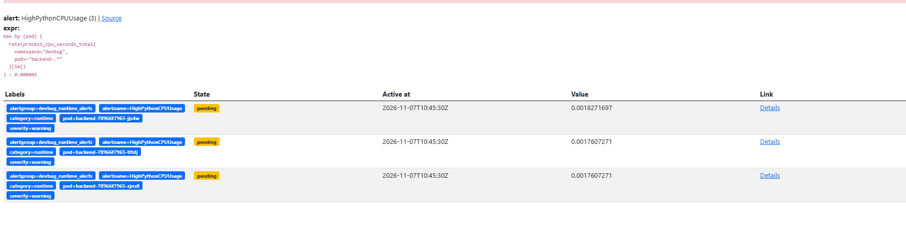

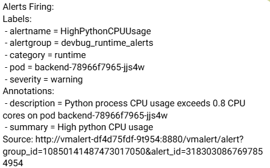

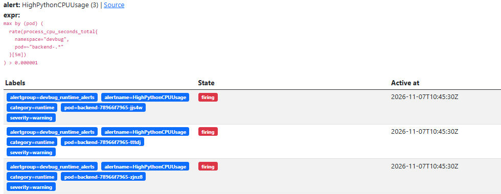

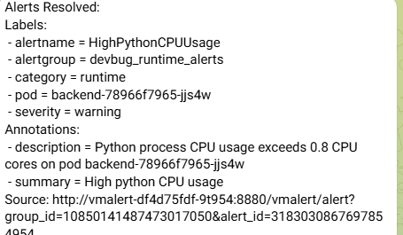

Срабатывание алерта на задержку ответов

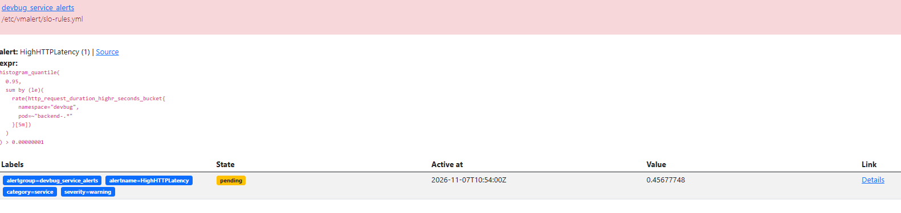

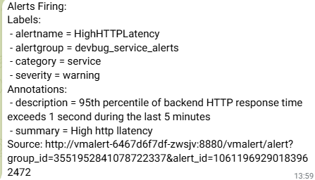

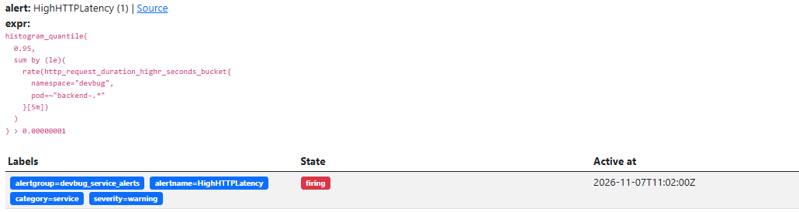

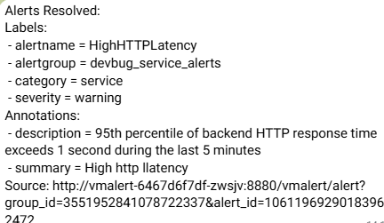

Срабатывание алерта на высокий процент HTTP-ошибок

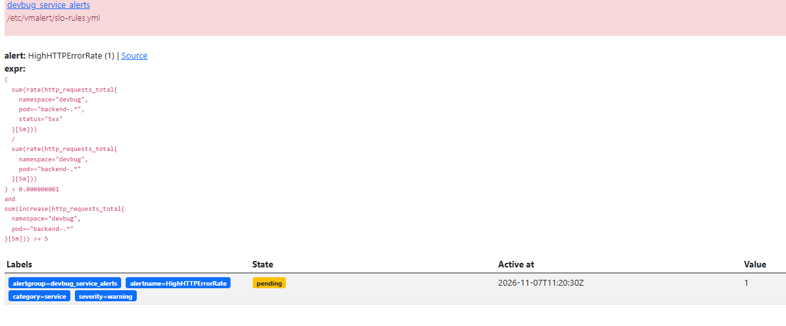

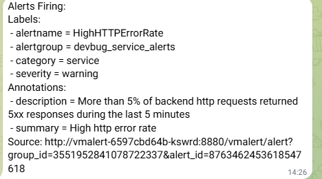

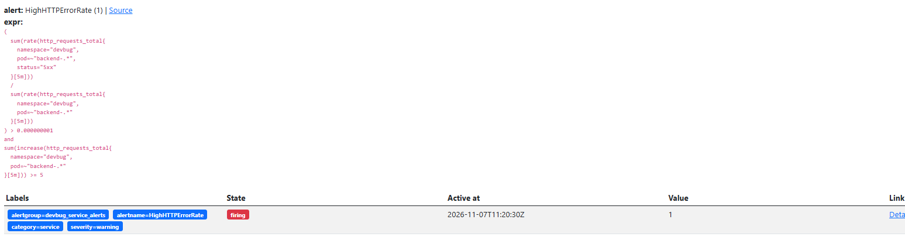

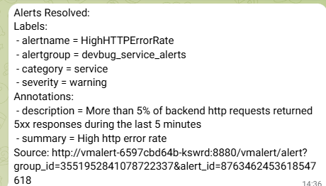
