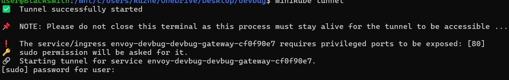
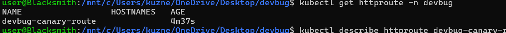
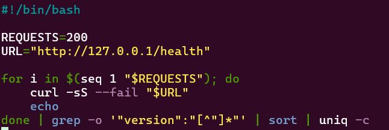
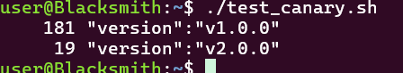

## 1. Используемые файлы

Для выполнения задания были созданы и использованы следующие файлы:

| Файл | Назначение |
|---|---|
| k8s/app/backend-deployment.yml | Deployment первой версии приложения |
| k8s/app/backend-service.yml | Service типа ClusterIP для первой версии приложения|
| k8s/app/backend-v2-deployment.yml | Deployment второй версии приложения|
| k8s/app/backend-v2-service.yml | Service типа ClusterIP для второй версии приложения |
| k8s/gateway/gateway.yml | Создание Gateway с HTTP Listener на порту 80, обеспечивающего точку входа для входящего трафика |
| k8s/gateway/httproute-canary.yml | Настройка HTTPRoute с распределением входящего трафика между первой и второй версиями приложения в соотношении 90/10 |
| test_canary.sh | Bash-скрипт для отправки 200 HTTP-запросов и подсчёта количества ответов от каждой версии приложения |

## 2. Развёртывание

Для доступа к Gateway был запущен minikube tunnel

После запуска туннеля была проверена конфигурация HTTPRoute

Для проверки распределения запросов был создан Bash-скрипт test_canary.sh, который отправляет 200 HTTP-запросов на /health, получает версии приложений из ответов и подсчитывает количество запросов, обработанных каждой версией.

Создание скрипта 

Запустим скрипт

Из 200 запросов:
- 181 запрос был обработан первой версией приложения;
- 19 запросов был обработан второй версией приложения.

Полученные результаты практически соответствуют заданным коэффициентам и подтверждают корректную работу маршрутизации