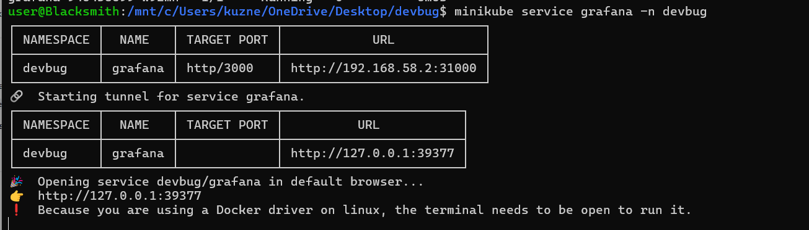
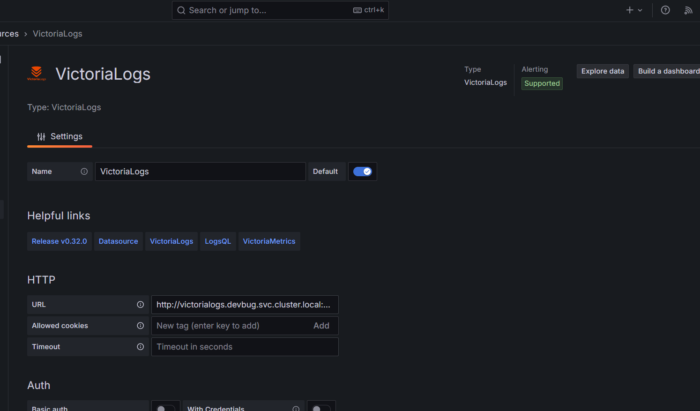
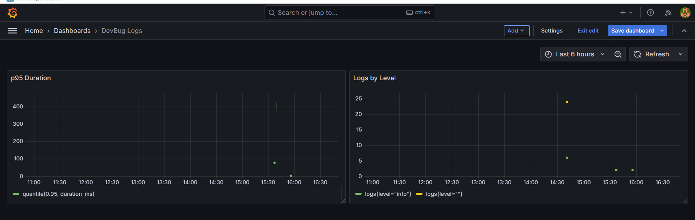

## Логирование

Перед выполнением практической работы в проект было доабвлено логирование при помощи structlog. настройки логирования находятся в backend/app/logger.py.
В логах не прописываются секретные данные, имена пользователей, содержание багов и комментариев. Используются только ID объектов.

## Настройка Victoria Logs

Для развёртывания Victoria Logs были использованы манифесты
`Deployment` + `Service` + `PVC`

| Файл                              | Назначение                                                                                         |
| --------------------------------- | -------------------------------------------------------------------------------------------------- |
| `k8s/victorialogs-pvc.yml`        | PVC на 2 GB для хранения логов на диске                                                            |
| `k8s/victorialogs-deployment.yml` | Deployment с одной репликой Victoria Logs. Монтирует PVC в `/victoria-logs-data`, retention 7 дней |
| `k8s/victorialogs-service.yml`    | ClusterIP-сервис на порту 9428                                                                     |

Lоставка логов настроена через DaemonSet. Выбор обусловлен тем, что:

- Vector читает логи локально с каждой ноды;
- При добавлении новой ноды vector автоматически запустится на ней;
- Используется один агент на ноду

| Файл                       | Назначение                                                                                                                               |
| -------------------------- | ---------------------------------------------------------------------------------------------------------------------------------------- |
| `k8s/vector-rbac.yml`      | ServiceAccount + ClusterRole + ClusterRoleBinding. Даёт Vector права читать `pods`, `namespaces`, `nodes` из Kubernetes API              |
| `k8s/vector-configmap.yml` | ConfigMap с `vector.toml`. Описывает source (`kubernetes_logs`), transform (парсинг JSON), sink (Elasticsearch Bulk API в Victoria Logs) |
| `k8s/vector-daemonset.yml` | DaemonSet Vector                                                                                                                         |

В `vector.toml` указаны заголовки `VL-Msg-Field=event`, `VL-Time-Field=timestamp`, `VL-Stream-Fields=service` для маппинга логов на `_msg`, `_time`, `_stream` в Victoria Logs.

## Выполнение запросов

### 1. Получение сырых записей за последние 30 минут

### 2. Фильтр по полю request_finished

### 3. Запрос с группировкой по уровню

### 4. Агрегирующий запрос

## Добавление Grafana

Для визуализации логов была добавлена Grafana, которая подключается к Victoria Logs через официальный плагин `victoriametrics-logs-datasource` и позволяет строить дашборды на LogsQL-запросах.

Grafana развёрнута через манифесты:

| Файл                         | Назначение                                                                                   |
| ---------------------------- | -------------------------------------------------------------------------------------------- |
| `k8s/grafana-secret.yml`     | Secret с admin-паролем                                                                       |
| `k8s/grafana-pvc.yml`        | PVC на 1 GB для хранения дашбордов и настроек                                                |
| `k8s/grafana-deployment.yml` | Deployment Grafana 11.3.0. Устанавливает плагин `victoriametrics-logs-datasource` при старте |
| `k8s/grafana-service.yml`    | NodePort-сервис для доступа из браузера                                                      |

### Работающая Grafana

### Настройка источника данных

### Настроенные дашборды

