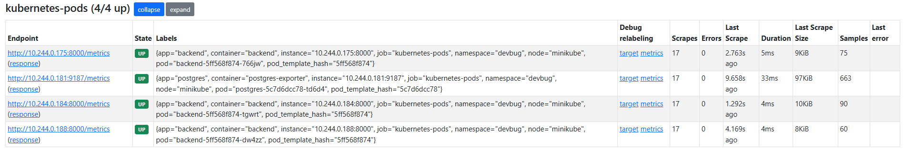
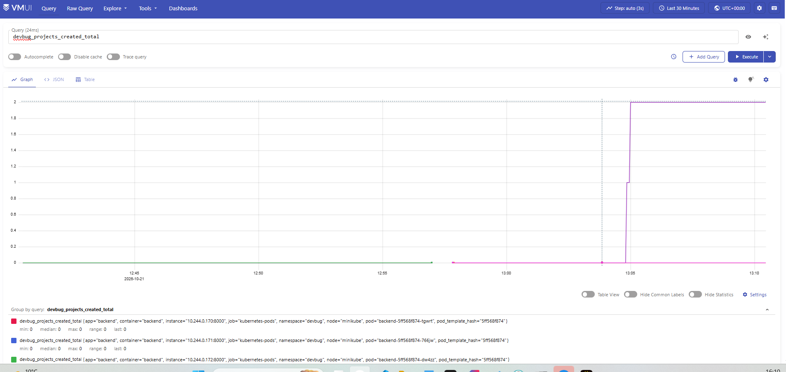
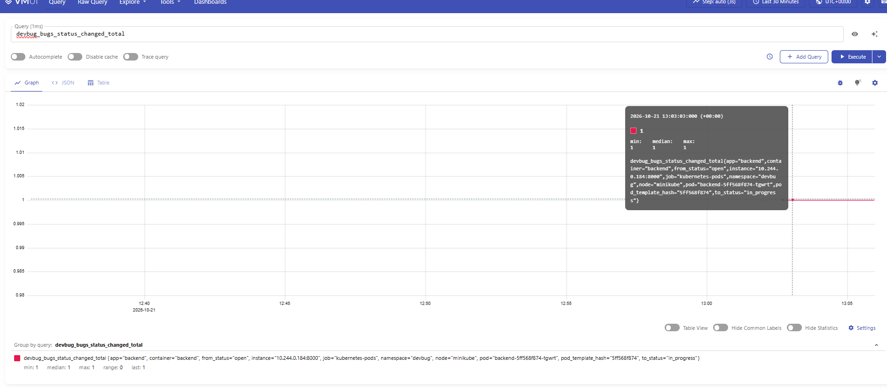
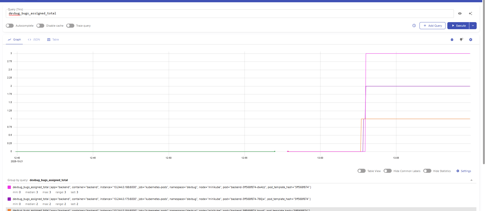
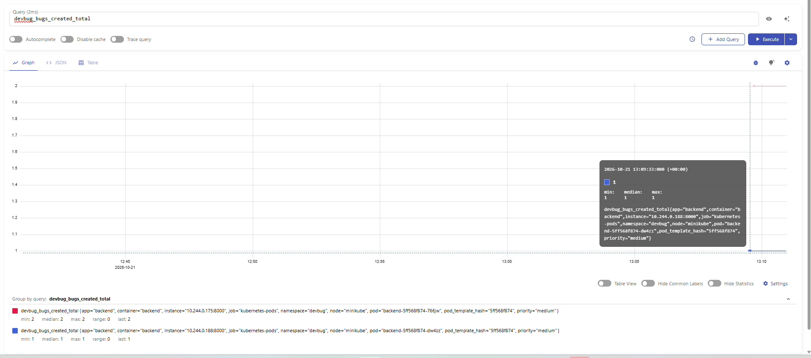

## Работа с метриками

Для сбора метрик развёрнуты Victoria Metrics (хранилище) и vmagent, который автоматически находит поды по аннотациям и забирает с них метрики.

В FastAPI метрики отдаются через библиотеку `prometheus-fastapi-instrumentator`, в PostgreSQL — через sidecar-контейнер `postgres-exporter`. Все собранные данные сохраняются в Victoria Metrics и визуализируются в vmui.

Страница http://localhost:8429/targets показывает, что vmagent автоматически обнаружил все поды (backend и postgres) по аннотациям prometheus.io/scrape. Все таргеты в статусе UP.

## Реализованные бизнес-метрики

### 1. `devbug_bugs_created_total` (с меткой `priority`)

Показывает, сколько багов заводится в системе и с какой критичностью. Это помогает понять нагрузку на команду и приоритеты в разработке.

В UI VictoriaMetrics выполнен запрос devbug_projects_created_total. Во всплывающей подсказке можно посмотреть метки.

### 2. `devbug_bugs_status_changed_total` (с метками `from_status`, `to_status`)

Отражает движение багов по воронке (open -> in_progress -> closed). Позволяет увидеть, на каком этапе задачи «застревают» и как быстро команда закрывает баги.

В vmui выполнен запрос devbug_bugs_status_changed_total. На графике видно изменение счётчика, а во всплывающей подсказке отображаются метки from_status="open" и to_status="in_progress".

### 3. `devbug_bugs_assigned_total`

Показывает, сколько раз баги назначались на исполнителей. Помогает оценить распределение нагрузки и понять, не висят ли задачи без ответственного.

В vmui выполнен запрос devbug_bugs_assigned_total. График отображает рост счётчика при назначении багов на исполнителей.

### 4. `devbug_projects_created_total`

Показывает рост числа проектов в системе. Это индикатор масштабирования использования продукта и активности пользователей.

В vmui выполнен запрос devbug_projects_created_total.

## Метрики рантайма и PostgreSQL

- **Метрики рантайма FastAPI:** собираются через `prometheus-fastapi-instrumentator` на эндпоинте `/metrics` (порт 8000). Включают стандартные HTTP-метрики (`http_requests_total`).

- **Метрики PostgreSQL:** собираются через sidecar `postgres-exporter` на порту 9187. Включают метрики доступности (`pg_up`), размера БД и блокировок.
