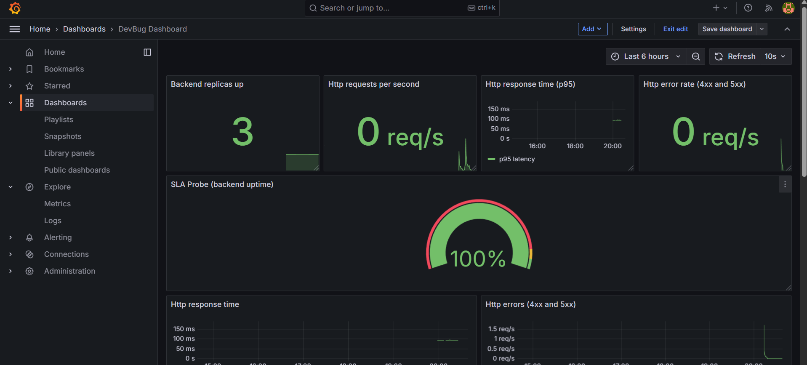
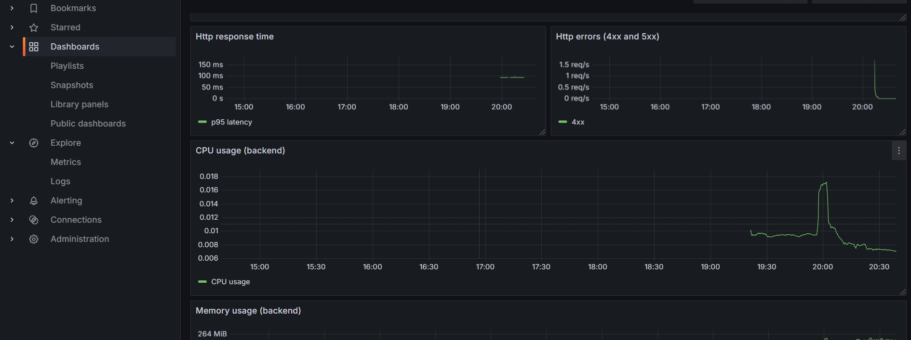
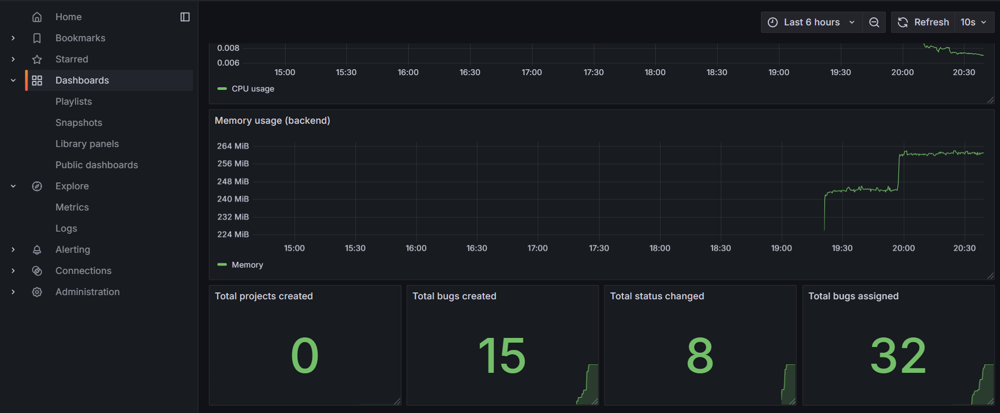
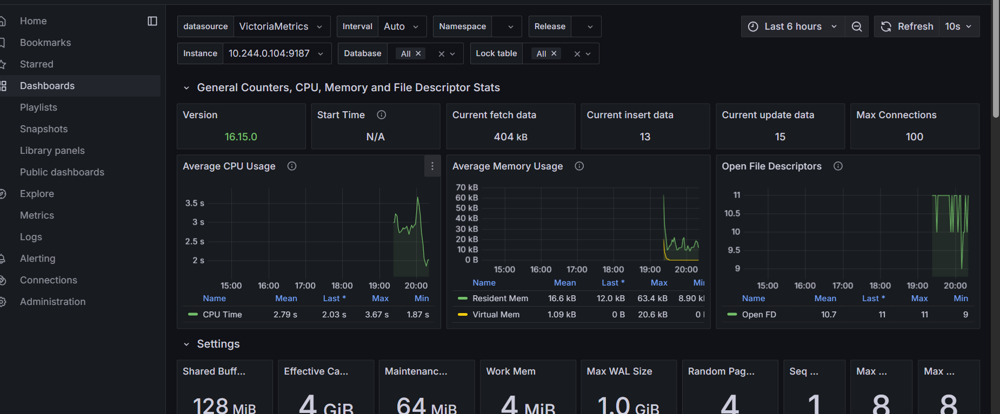

## Мониторинг при помощи Grafana

## Источники данных

Для мониторинга приложения используется VictoriaMetrics. В неё поступают метрики backend: HTTP-запросы, ошибки, время ответа, использование ресурсов и пользовательские показатели. Данные собираются с помощью vmagent.

Для мониторинга базы данных PostgreSQL используется PostgreSQL Exporter.

## DevBug Dashboard

На дашборде представлены метрики доступности, производительности и использования ресурсов приложения, а также пользовательские показатели. Панели выбраны на основе подходов RED и USE: они позволяют контролировать количество запросов, ошибки, задержки и загрузку ресурсов.

1. Backend replicas up

Показывает количество работающих реплик backend, еобходима для контроля доступности серверной части.

2. HTTP requests per second

Отображает количество HTTP-запросов в секунду, позволяет оценить текущую нагрузку на приложение.

3. HTTP error rate

Показывает долю HTTP-запросов, завершившихся ошибками, используется для контроля качества работы API и выявления роста количества ошибок.

4. HTTP response time p95

Отображает 95-й перцентиль времени ответа сервера. Показывает, за какое время обрабатываются 95% запросов, помогает выявлять замедление приложения.

5. HTTP response time

График изменения времени обработки HTTP-запросов во времени. Позволяет отслеживать скачки задержек и оценивать стабильность работы серверной части.

6. HTTP errors (4xx and 5xx)

Отображает количество клиентских ошибок (4xx) и серверных ошибок (5xx). Позволяет определить вид возникающих проблем и отследить их динамику.

7. CPU usage

Показывает использование CPU. Необходима для контроля нагрузки и выявления возможной нехватки вычислительных ресурсов.

8. Memory usage

Отображает объём используемой оперативной памяти. Позволяет контролировать потребление памяти и выявлять утечки.

9. SLA Probe (backend uptime)

Показывает доступность backend в процентах на основе показателя SLI.

Формула:

```promql
avg(sli:backend_uptime:ratio_rate1m{app="backend"}) * 100
```

Значение рассчитывается как средняя доля времени доступности backend, умноженная на 100. Панель необходима для контроля выполнения требований к доступности сервиса.

10. Total bugs created

Отображает общее количество созданных задач, позволяет отслеживать активность пользователей и использование основной функциональности приложения.

11. Total projects created

Показывает общее количество созданных проектов, используется для контроля активности по созданию проектов.

12. Total bugs assigned

Отображает количество назначений задач пользователям, позволяет оценивать использование механизма распределения задач.

13. Total status changes

Показывает общее количество изменений статусов задач, позволяет отслеживать активность работы с задачами.

### Общий вид дашборда







## PostgreSQL Dashboard

Импортирован готовый дашборд PostgreSQL Exporter, который отображает показатели работы базы данных: количество подключений, операции чтения и записи, использование CPU и памяти, а также другие системные показатели.

Дашборд необходим для мониторинга состояния PostgreSQL и выявления возможных проблем с производительностью базы данных.

### Дашборд PostgreSQL


